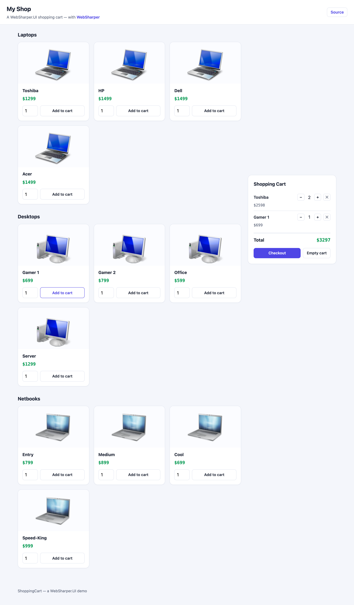

# Shopping Cart with WebSharper UI

A small shopping-cart demo built with
[WebSharper](https://websharper.com) and WebSharper.UI — a reactive
[`ListModel`](https://websharper.com) of cart items with per-item quantity
controls and a live total.

[](https://websharper-samples.github.io/ShoppingCart)

**[Try it live](https://websharper-samples.github.io/ShoppingCart)**

## What it shows

- A reactive `ListModel<string, CartItem>` rendered with `DocSeqCached`, so
  adding an item, changing its quantity or removing it updates the cart and its
  total without re-rendering the rest.
- A single HTML template (`src/wwwroot/index.html`) loaded with
  `ClientLoad.FromDocument`, with `ws-children-template` sub-templates for the
  product families, products and cart rows, filled in and bound with `.Bind()`.
- Nested collection rendering: families → products, each a template instance.
- A pure client-side single-page app — no server round-trips — so it hosts
  happily on GitHub Pages.

## Running locally

```
dotnet run --project src
```

Then open <http://localhost:5328>.

## Building

```
dotnet build src/ShoppingCart.fsproj -c Release
```

WebSharper compiles the client and [esbuild](https://esbuild.github.io/) bundles
it into `src/wwwroot/Scripts` for Release.

## Deployment

Every push to `master` builds in Release and publishes `src/wwwroot` to the
`gh-pages` branch via `.github/workflows/deploy.yml`.
